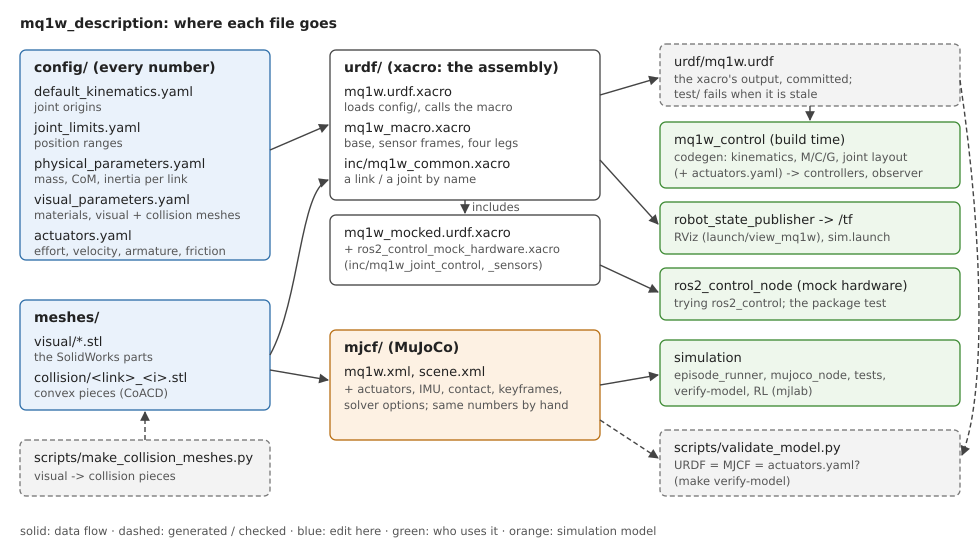

mq1w_description (tiếng Việt)
=============================

Bản mô tả vật lý của robot bốn chân MQ1W (chân-bánh (wheel-legged)) cho ROS 2: các khâu và khớp, khối
lượng và quán tính của chúng, hình dạng và hình va chạm, động cơ, và mô hình MuJoCo. Gói chỉ chứa
dữ liệu; mọi gói khác của stack điều khiển đều đọc robot từ đây.

`English <../index.html>`_

.. toctree::
   :maxdepth: 2
   :caption: Mục lục

   robot_frames
   migration_notes

.. contents::
   :depth: 2
   :local:

Robot
-----

.. list-table::
   :widths: 30 70

   * - động cơ
     - 16 × Unitree GO-M8010-6 (4 chân × hip, thigh, calf, wheel)
   * - bàn chân
     - một bánh xe (lốp hình trụ) ở cuối mỗi calf, quay liên tục
   * - khối lượng
     - 20.27 kg (đã gồm động cơ)
   * - chiều cao thân khi đứng / nằm
     - 0.3965 m / 0.2052 m (keyframe ``home`` / ``lie_down`` của MJCF)
   * - số khâu / khớp
     - 22 / 21, trong đó 16 khớp chuyển động (:doc:`robot_frames`)

Vì sao gói được chia như vậy
----------------------------

Hai quy ước, một ở ngoài và một ở trong:

- **Mỗi robot một gói**, giống ``unitree_ros/robots`` của Unitree (``go2_description``, ...). MQ1 và
  MQ1W khác nhau ở chân (quả cầu so với bánh xe), và stack điều khiển tìm robot theo tên gói:
  mỗi robot là bộ ba ``<robot>_description`` → ``<robot>_control`` → ``<robot>_mujoco``.
- **Bên trong, giống** ``ur_description`` **của Universal Robots**: mọi con số nằm trong file
  config, xacro chỉ lắp ráp chúng. Mỗi con số chỉ sửa ở một chỗ; một robot đã hiệu chuẩn là một
  file config khác, không phải một xacro khác.

Cấu trúc
--------

.. code-block:: text

   mq1w_description/
   ├── config/      mọi con số (sửa ở đây)
   ├── urdf/        xacro lắp ráp chúng, và URDF sinh ra
   ├── meshes/      visual/: các chi tiết; collision/: các mảnh lồi của chúng
   ├── mjcf/        mô hình MuJoCo
   ├── launch/      view_mq1w.launch.py / .xml: xem robot trong RViz
   ├── rviz/        view_robot.rviz
   ├── test/        các kiểm tra
   └── doc/         tài liệu này

Các file cấu hình
-----------------

Giá trị được ghi theo từng khớp, từng khâu (không suy ra bằng quy tắc đối xứng): robot không đối
xứng hoàn toàn (thigh sau quay được xa hơn về phía sau 60° so với thigh trước, và mỗi chi tiết
trái / phải có quán tính đo riêng).

.. list-table::
   :header-rows: 1
   :widths: 32 68

   * - file
     - chứa
   * - ``config/default_kinematics.yaml``
     - gốc của từng khớp trong khâu cha: x, y, z (m), roll, pitch, yaw (rad). Như UR, đây là
       hình học danh định; robot đã hiệu chuẩn dùng một bản riêng (``kinematics_params:=``).
   * - ``config/joint_limits.yaml``
     - khoảng góc của từng khớp quay (rad)
   * - ``config/physical_parameters.yaml``
     - khối lượng (kg), trọng tâm (m) và tensor quán tính (kg m², quanh trọng tâm) của từng khâu,
       lấy từ các chi tiết SolidWorks
   * - ``config/visual_parameters.yaml``
     - màu (rgba); với mỗi khâu: mesh hình ảnh và hình va chạm
   * - ``config/initial_positions.yaml``
     - vị trí khớp lúc phần cứng ros2_control khởi động (tư thế đứng)
   * - ``config/actuators.yaml``
     - động cơ theo loại khớp: mô-men, tốc độ, armature (quán tính rotor), tỉ số truyền sau động
       cơ; giảm chấn và ma sát khớp (ASSUMED). Các khóa của ``joints`` là các loại khớp của chân:
       nhờ đó stack điều khiển biết bố cục khớp.

Mô-men, tốc độ, giảm chấn và ma sát chỉ nằm trong ``actuators.yaml``; xacro đọc chúng từ đó. Test
của gói báo lỗi nếu có mục config nào không được mô hình dùng.

Các file URDF
-------------

.. list-table::
   :header-rows: 1
   :widths: 38 62

   * - file
     - vai trò
   * - ``urdf/mq1w.urdf.xacro``
     - robot (như ``ur.urdf.xacro``): các arg, các file config, lời gọi macro
   * - ``urdf/mq1w_macro.xacro``
     - robot dưới dạng macro (như ``ur_macro.xacro``): ``base_link``, ``base``, các frame cảm
       biến, bốn chân
   * - ``urdf/inc/mq1w_common.xacro``
     - bộ dựng (như ``inc/ur_common.xacro``): dựng một khâu hoặc một khớp theo tên, lấy số từ các
       file config; bản thân nó không chứa con số nào
   * - ``urdf/mq1w_mocked.urdf.xacro``
     - robot cộng một hệ ros2_control trên phần cứng giả lập (như ``ur_mocked.urdf.xacro``)
   * - ``urdf/ros2_control_mock_hardware.xacro``
     - hệ đó: ``mock_components/GenericSystem``, các khớp của ``inc/mq1w_joint_control.xacro``,
       IMU của ``inc/mq1w_sensors.xacro``
   * - ``urdf/mq1w.urdf``
     - output của ``mq1w.urdf.xacro``, được commit: bộ sinh code của stack đọc nó lúc build.
       Không bao giờ sửa tay.

Các arg của ``mq1w.urdf.xacro`` (để trống là dùng file trong ``config/``; file khác thì truyền
đường dẫn tuyệt đối):

.. list-table::
   :header-rows: 1
   :widths: 30 70

   * - arg
     - file
   * - ``kinematics_params``
     - ``default_kinematics.yaml``
   * - ``joint_limit_params``
     - ``joint_limits.yaml``
   * - ``physical_params``
     - ``physical_parameters.yaml``
   * - ``visual_params``
     - ``visual_parameters.yaml``
   * - ``actuator_params``
     - ``actuators.yaml``

``mq1w_mocked.urdf.xacro`` nhận các arg này cùng ``initial_positions_file``, ``mock_sensor_commands``.

.. code-block:: bash

   cd mq1w_description
   xacro urdf/mq1w.urdf.xacro -o urdf/mq1w.urdf                          # sau khi sửa config
   xacro urdf/mq1w.urdf.xacro kinematics_params:=/duong/dan/calibrated.yaml
   xacro urdf/mq1w_mocked.urdf.xacro                                     # kèm ros2_control

Gói này không chạy bộ điều khiển nào: như UR, việc chạy robot là của driver, ở đây là
``mq1w_control`` (``control_node``, qua ``legged_msgs/LowCmd`` / ``LowState``).

Mesh
----

- ``meshes/visual/`` (26 file STL): các chi tiết SolidWorks, tô màu theo material trong
  ``visual_parameters.yaml``.
- ``meshes/collision/`` (140 file STL): mesh hình ảnh của từng khâu được
  ``scripts/make_collision_meshes.py`` (CoACD) cắt thành các mảnh lồi. MuJoCo va chạm một mesh
  theo bao lồi của nó, nên chi tiết lõm (thigh, vỏ thân) cần nhiều mảnh.
- Phần tiếp xúc với sàn giữ hình khối có sẵn: hình trụ của lốp.
  Nó lăn trơn tru (bao lồi thì có cạnh), và bộ sinh code đọc bán kính của nó.

Mô hình MuJoCo
--------------

``mjcf/mq1w.xml`` là robot cho MuJoCo, ``mjcf/scene.xml`` thêm sàn. Ngoài những gì URDF có, nó chứa
những thứ chỉ bộ mô phỏng cần: actuator (giới hạn mô-men, quán tính rotor), site của IMU, thông số
tiếp xúc, keyframe ``home`` và ``lie_down``, tùy chọn bộ giải
, và ``<exclude>`` cho mỗi bánh xe với thigh của chính nó (cách nhau 2.5 mm ở điểm dừng của gối).
Nó được dùng bởi ``episode_runner``, ``mujoco_node``, test của gói control, ``make verify-model``
và huấn luyện RL. Các con số chung với URDF được giữ bằng nhau bằng tay, và
``scripts/validate_model.py mq1w`` (trong ``make verify-model``) kiểm tra: khối lượng, trọng tâm,
quán tính, gốc khớp, trục, giới hạn, mô-men, armature, giảm chấn, ma sát, số hình va chạm, và ở
mỗi keyframe chỉ bánh xe chạm sàn.

Xem robot
---------

.. code-block:: bash

   ros2 launch mq1w_description view_mq1w.launch.py                 # hoặc view_mq1w.launch.xml
   ros2 launch mq1w_description view_mq1w.launch.py gui:=false      # joint_state_publisher, không có thanh trượt
   ros2 launch mq1w_description view_mq1w.launch.py rviz:=false     # chỉ chạy các node

``view_mq1w.launch.xml`` chứa các arg (``rviz_config_file``, ``description_file``, ``gui``,
``rviz``) và các node; file Python chỉ include nó, giống UR.

Test
----

``make test`` (hoặc ``colcon test --packages-select mq1w_description``) chạy:

- ``test/test_mq1w_urdf_xacro.py``: xacro chạy được và bằng ``urdf/mq1w.urdf``; một cây có gốc
  ``base_link``; mọi mesh đều có file; bản mocked đúng bằng robot cộng ros2_control, gồm mọi khớp
  chuyển động trong giới hạn của chúng; mọi mục config đều được dùng.
- ``test/test_view_mq1w_launch.py``: cả hai file launch chạy được (không mở cửa sổ, ROS domain 77,
  namespace riêng) và ``/tf`` cùng ``/tf_static`` có đủ mọi khâu.

Sửa mô hình
-----------

.. list-table::
   :header-rows: 1
   :widths: 30 40 30

   * - muốn đổi
     - sửa
     - rồi
   * - một con số (gốc khớp, giới hạn, khối lượng)
     - file trong ``config/``, và cùng con số đó trong ``mjcf/mq1w.xml``
     - sinh lại ``urdf/mq1w.urdf``; ``make verify-model``; ``make test``
   * - hình dạng một chi tiết
     - file STL của nó trong ``meshes/visual/``
     - ``scripts/make_collision_meshes.py mq1w``; sinh lại URDF; các kiểm tra như trên
   * - động cơ
     - ``actuators.yaml`` và MJCF
     - như với một con số

MJCF không được sinh tự động: ngoài collision mesh, mọi thay đổi mô hình phải sửa ở cả file config
lẫn MJCF, và ``validate_model.py`` bắt được nếu quên một bên.
