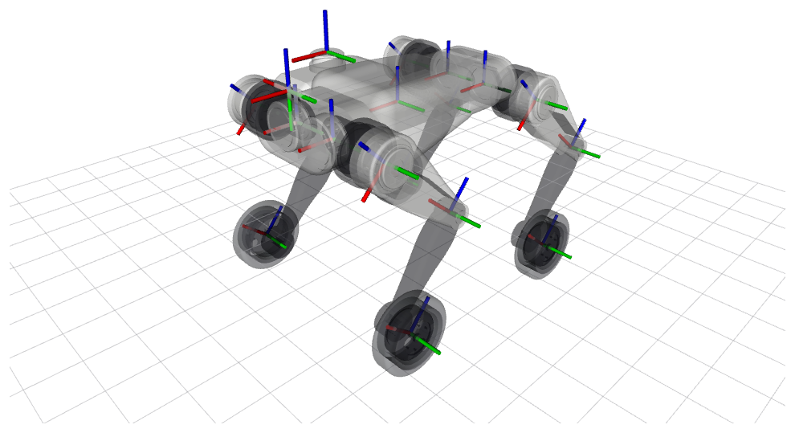
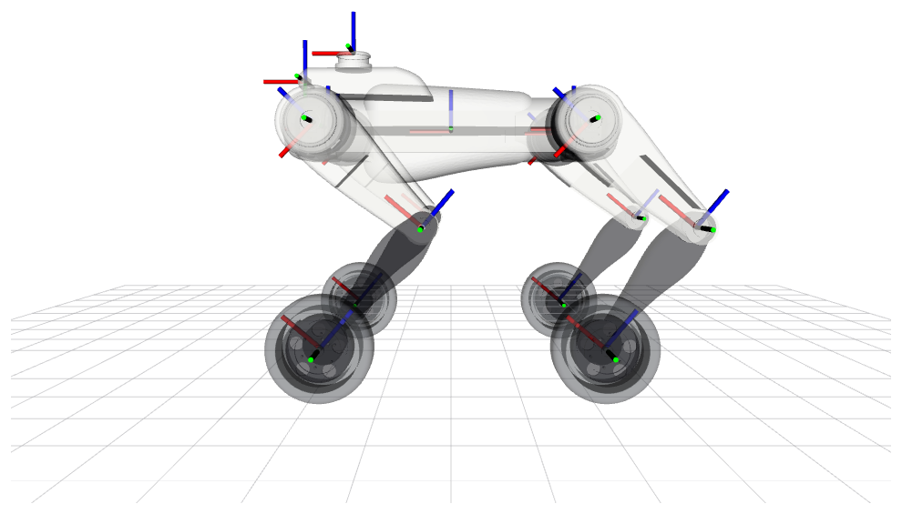

Các frame của robot
===================

Các frame của mô hình MQ1W, quy ước của chúng và ý nghĩa góc của từng khớp. Các con số dưới
đây là của ``config/default_kinematics.yaml`` và ``config/joint_limits.yaml``; hai file đó là
nguồn chuẩn.

.. contents::
   :local:

Quy ước
-------

- Mọi frame theo `REP-103 <https://ros.org/reps/rep-0103.html>`_: **x tiến, y trái, z lên**, hệ
  tay phải; độ dài tính bằng m, góc bằng rad.
- Chân đặt tên theo góc: **FL** (trước trái), **FR** (trước phải), **RL** (sau trái), **RR** (sau
  phải). Stack điều khiển xếp khớp theo thứ tự FL, FR, RL, RR, và trong mỗi chân là hip, thigh, calf, wheel
  (các khóa của ``actuators.yaml joints``).
- Góc khớp dương làm khâu con quay quanh trục khớp theo quy tắc bàn tay phải.

Cây frame
---------

.. code-block:: text

   base_link                     gốc, không có khối lượng
   └ base                        thân robot: khối lượng, quán tính, mesh
     ├ imu_link                  IMU
     ├ lidar_link                lidar
     ├ camera_link               camera
     │ └ camera_optical_frame    frame quang học của camera
     ├ FL_hip
     │ └ FL_thigh
     │   └ FL_calf
     │     └ FL_wheel
     ├ FR_hip ...                (và RL, RR: cùng một chuỗi)

- ``base_link`` là gốc của cây, ở gốc tọa độ của thân, không gắn gì. Giống ``base_link`` của UR, nó
  không mang quán tính vì KDL (và vì thế ``robot_state_publisher``) không chấp nhận quán tính ở
  khâu gốc.
- ``base`` là chính thân robot, cùng vị trí và hướng với ``base_link``. Trong MuJoCo đây là vật thể
  tự do; trạng thái mà stack điều khiển ước lượng (vị trí, hướng, vận tốc) là của ``base``.

Frame cảm biến
--------------

.. list-table::
   :header-rows: 1
   :widths: 26 28 46

   * - frame
     - vị trí trong ``base`` (m)
     - hướng
   * - ``imu_link``
     - (0, 0, 0)
     - như ``base``: gyro và gia tốc kế của IMU đo trong frame này (site ``imu`` của MJCF)
   * - ``lidar_link``
     - (0.165, 0, 0.132)
     - như ``base``
   * - ``camera_link``
     - (0.2471, 0, 0.084)
     - như ``base`` (x hướng tới trước)
   * - ``camera_optical_frame``
     - tại ``camera_link``
     - quy ước quang học REP-103: **z tới trước, x sang phải, y xuống dưới** (roll −π/2, yaw −π/2)

Các chân
--------

Trong cột gốc khớp, ± là + với chân trước (theo x) hoặc chân trái (theo y), và − với chân sau hoặc
chân phải: chân phải đối xứng với chân trái theo y, hông chân sau nằm ở x âm.

.. list-table::
   :header-rows: 1
   :widths: 20 9 21 7 20 23

   * - khớp
     - cha
     - gốc (m)
     - trục
     - giới hạn (rad)
     - góc dương thì
   * - ``<leg>_hip_joint``
     - base
     - (±0.2, ±0.05, 0)
     - x
     - [−0.6, 0.6]
     - bàn chân dịch sang trái (+y): ra ngoài với chân trái, vào trong với chân phải
   * - ``<leg>_thigh_joint``
     - hip
     - (0, ±0.129, 0)
     - y
     - trước [−1.5708, 3.4907], sau [−0.5236, 4.5379]
     - chân vung ra sau
   * - ``<leg>_calf_joint``
     - thigh
     - (0, 0, −0.22)
     - y
     - [−2.55, −0.84]
     - duỗi gối (góc luôn âm: càng âm gối càng gập)
   * - ``<leg>_wheel_joint``
     - calf
     - (0, ±0.042, −0.22)
     - y
     - liên tục
     - bánh lăn tới (+x)

Thigh và calf đều dài 0.22 m. Động cơ cho 23.7 N·m, 30.1 rad/s ở hip, thigh và bánh xe, và 35.6 N·m, 20.1 rad/s ở calf
(qua thêm bộ truyền 1.5:1; ``actuators.yaml``).

Bánh xe
-------

``<leg>_wheel`` là tâm bánh xe, ở cuối calf và lệch ra ngoài 0.042 m. Bánh quay quanh trục y không
giới hạn; vận tốc dương làm robot lăn tới. Hình va chạm của nó là hình trụ của lốp (bán kính
0.075 m, bề rộng 0.044 m). Bánh chạm sàn ở vành, ngay dưới tâm *trong mặt phẳng bánh*, nên khi thân
nghiêng ngang thì điểm tiếp xúc dịch chuyển trên vành (``FootContacts`` của stack điều khiển có tính
điều này).

Các tư thế
----------

.. list-table::
   :header-rows: 1
   :widths: 18 22 60

   * - tư thế
     - hip, thigh, calf
     - mô tả
   * - zero
     - 0, 0, 0
     - mọi chân thẳng đứng, bàn chân thấp hơn hông 0.44 m. Chỉ là tư thế tham chiếu: calf bằng 0
       nằm ngoài giới hạn của nó.
   * - đứng
     - 0, 0.8, −1.5
     - ``initial_positions.yaml``, keyframe ``home`` của MJCF. Bàn chân ở sau hông 0.016 m và thấp
       hơn hông 0.3215 m, gối hướng ra sau; thân cao 0.3965 m so với sàn.
   * - nằm
     - 0, 1.25, −2.55
     - keyframe ``lie_down`` của MJCF (calf ở điểm dừng); thân cao 0.2052 m.

   Robot ở tư thế đứng với mọi frame (x đỏ, y xanh lá, z xanh dương).

   Nhìn từ bên trái, phía trước ở bên trái ảnh: gối hướng ra sau.
